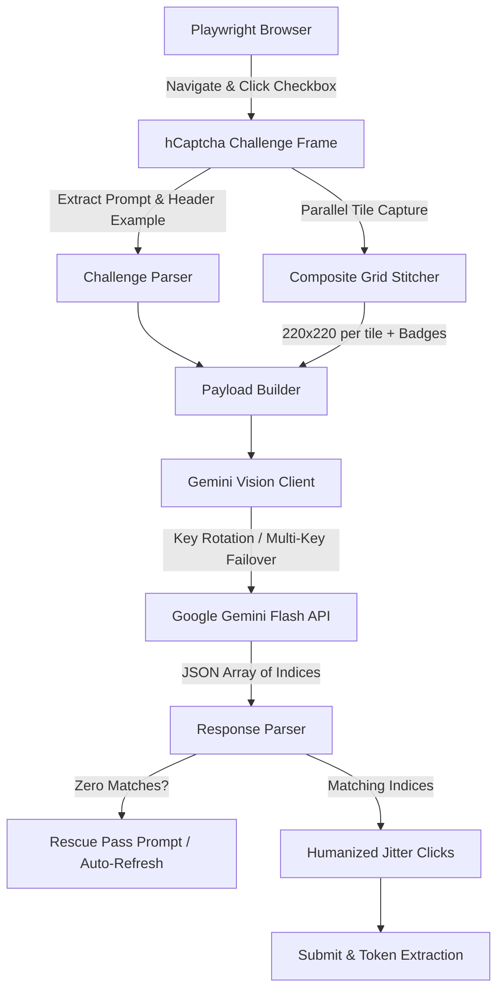

# Hcaptcha-solver

An automated testing and QA evaluation tool for hCaptcha challenges built with **Playwright** and **Google Gemini Flash Vision** (`gemini-3.5-flash-lite`).

> [!NOTE]
> **Scope & Environment Notice**: This tool is designed and evaluated strictly on designated developer demonstration and benchmark testbeds (e.g., `https://nopecha.com/demo/hcaptcha` and standard hCaptcha test credentials). It is intended for authorized QA testing, accessibility benchmarking, and visual AI model evaluation.

---

## Architecture & Features



* **Google Gemini Flash Vision Engine**: Powered by Google AI's `gemini-3.5-flash-lite` with sub-second visual reasoning and structured JSON output.
* **Dual-Key Automatic Failover**: Automatically rotates between `GEMINI_API_KEY` and `GEMINI_API_KEY_FALLBACK` when encountering HTTP `429` rate limits or quota exhaustion.
* **High-Res Composite Grid Stitching**: Captures all 9 challenge tiles in parallel and stitches them into a single high-resolution image (220×220 per tile) with numbered badges. This reduces 9 individual API calls into a single fast visual request.
* **Header Example Image Alignment**: Automatically detects and extracts reference sample images from the challenge header, passing them directly to Gemini for visual comparison.
* **Zero-Match Dynamic Rescue**: If the initial visual pass returns 0 matching tiles, the solver automatically executes a secondary rescue evaluation or triggers a challenge refresh.
* **Natural Jittered Interaction**: Clicks matching tiles with randomized bounding-box coordinate offsets (35% to 65%) and variable human-like intervals (120–240ms).
* **Dual Interfaces**: Includes a direct CLI solver (`ai_solver.py`) and an asynchronous REST API (`api_server.py`) with background job management.

---

## Directory Structure

| File | Purpose |
|---|---|
| [`ai_solver.py`](file:///home/nexus/Desktop/hcaptcha-solver/hcaptcha-testing-tool/ai_solver.py) | Core visual solver with Gemini client, composite grid stitching, and Playwright automation |
| [`api_server.py`](file:///home/nexus/Desktop/hcaptcha-solver/hcaptcha-testing-tool/api_server.py) | FastAPI REST service with `/solve`, `/solve/sync`, `/jobs/{id}`, and `/health` endpoints |
| [`config.py`](file:///home/nexus/Desktop/hcaptcha-solver/hcaptcha-testing-tool/config.py) | Environment loader with multi-key normalization and validation |
| [`captcha_service.py`](file:///home/nexus/Desktop/hcaptcha-solver/hcaptcha-testing-tool/captcha_service.py) | Server-side token verification against the hCaptcha API |
| [`browser_test.py`](file:///home/nexus/Desktop/hcaptcha-solver/hcaptcha-testing-tool/browser_test.py) | Playwright test routines for basic checkbox and token extraction |
| [`main.py`](file:///home/nexus/Desktop/hcaptcha-solver/hcaptcha-testing-tool/main.py) | Test runner executing server-side test token validations and generating JSON reports |
| [`test_captcha.py`](file:///home/nexus/Desktop/hcaptcha-solver/hcaptcha-testing-tool/test_captcha.py) | Pytest test suite for unit and integration testing |
| [`setup.sh`](file:///home/nexus/Desktop/hcaptcha-solver/hcaptcha-testing-tool/setup.sh) | Automated environment setup script |
| [`dashboard.html`](file:///home/nexus/Desktop/hcaptcha-solver/hcaptcha-testing-tool/dashboard.html) | Interactive web UI dashboard for testing and monitoring jobs |
| [`reports/`](file:///home/nexus/Desktop/hcaptcha-solver/hcaptcha-testing-tool/reports/) | Automated output directory for structured JSON execution logs |

---

## Setup & Installation

### 1. Automated Setup

Run the included setup script to install Python dependencies and Playwright Chromium:

```bash
chmod +x setup.sh
./setup.sh
```

### 2. Manual Installation

```bash
python3 -m venv .venv
source .venv/bin/activate
pip install -r requirements.txt
playwright install chromium
```

### 3. Configure API Keys

Edit or create `.env` in the root directory:

```env
# Google Gemini API Keys (Free from Google AI Studio: https://aistudio.google.com/)
GEMINI_API_KEY=your_primary_gemini_api_key
GEMINI_API_KEY_FALLBACK=your_secondary_gemini_api_key

# Testbed Target URL
HCAPTCHA_DEMO_URL=https://nopecha.com/demo/hcaptcha
BROWSER_HEADLESS=true
```

---

## Running the Tool

### Command-Line Interface (CLI)

Run a test solve directly on the demo testbed:

```bash
# Run headless solve and save JSON report
python3 ai_solver.py --save-report

# Show browser window during solve
python3 ai_solver.py --no-headless

# Test a custom URL with 5 maximum retries
python3 ai_solver.py --url "https://nopecha.com/demo/hcaptcha" --retries 5

# Verify token after solve against hCaptcha siteverify API
python3 ai_solver.py --verify
```

### REST API Server

Start the background FastAPI service:

```bash
python3 api_server.py
```
* **API Documentation**: Visit `http://localhost:8000/docs` in your browser.
* **Health Check**: `GET http://localhost:8000/health`
* **Submit Asynchronous Solve**:
  ```bash
  curl -X POST http://localhost:8000/solve \
    -H "Content-Type: application/json" \
    -d '{"url": "https://nopecha.com/demo/hcaptcha", "headless": true, "retries": 5}'
  ```
* **Poll Job Status**: `GET http://localhost:8000/jobs/{job_id}`
* **Synchronous Solve**: `POST http://localhost:8000/solve/sync`

### Server Verification & Pytest Suite

```bash
# Run server verification test suite
python3 main.py

# Run pytest suite
pytest test_captcha.py -v
```

---

## Demo Sites & Evaluation Scope

This project has been verified and tested against the following public testbeds:

1. **NopeCHA hCaptcha Demo**:
   * URL: `https://nopecha.com/demo/hcaptcha`
   * Characteristics: Multi-round 3×3 image classification challenges with header reference items and dynamic tile refreshing.
2. **hCaptcha Test Key Verification**:
   * Sitekey: `10000000-ffff-ffff-ffff-000000000001`
   * Secret Key: `0x0000000000000000000000000000000000000000`
   * Response: `10000000-aaaa-bbbb-cccc-000000000001`

---

## Extending the Script for Different Challenge Types

The architecture of [`ai_solver.py`](file:///home/nexus/Desktop/hcaptcha-solver/hcaptcha-testing-tool/ai_solver.py) is modular. Below are guides on how to adapt the code for other CAPTCHA formats:

### 1. Adapting for 4×4 Grids (16 Tiles)
The composite stitcher in [`GeminiVisionClient.classify_grid`](file:///home/nexus/Desktop/hcaptcha-solver/hcaptcha-testing-tool/ai_solver.py#L150) automatically handles arbitrary tile counts by calculating rows and columns dynamically:
```python
cols = 4 if len(tile_images) >= 16 else (3 if len(tile_images) >= 9 else 2)
rows = (len(tile_images) + cols - 1) // cols
```
To support 4×4 challenges, ensure that the prompt instruction informs Gemini of the upper index limit:
```python
prompt_text = (
    f"Challenge instruction: '{prompt}'.\n"
    f"The image shows a grid of tiles numbered 0 to {len(tile_images)-1}.\n"
    f"Return ONLY a JSON array of matching integer tile numbers, e.g. [0, 5, 12]."
)
```

### 2. Adapting for Bounding Box / Object Detection Challenges
In bounding box challenges, a single large image is displayed, and the user must draw rectangular boxes around targets:
1. **Capture the Main Image**: Instead of screenshotting individual tiles, capture the entire image container:
   ```python
   image_el = challenge_frame.locator(".challenge-image, .bounding-box-canvas")
   image_b64 = await _screenshot_element_b64(image_el)
   ```
2. **Prompt for Normalized Coordinates**:
   Request Gemini to output standard bounding boxes normalized to `[ymin, xmin, ymax, xmax]` on a `0-1000` scale:
   ```python
   prompt_text = (
       f"Identify all instances of '{prompt}' in this image.\n"
       f"Return ONLY a JSON array of bounding boxes: [{\"box_2d\": [ymin, xmin, ymax, xmax], \"label\": \"...\"}]"
   )
   ```
3. **Simulate Drag Events**: Convert the normalized coordinates to element pixel coordinates and perform mouse drag:
   ```python
   box = await image_el.bounding_box()
   start_x = box["x"] + (xmin / 1000) * box["width"]
   start_y = box["y"] + (ymin / 1000) * box["height"]
   end_x = box["x"] + (xmax / 1000) * box["width"]
   end_y = box["y"] + (ymax / 1000) * box["height"]

   await page.mouse.move(start_x, start_y)
   await page.mouse.down()
   await page.mouse.move(end_x, end_y, steps=10)
   await page.mouse.up()
   ```

### 3. Adapting for Coordinate / Point-Click Challenges
For tasks such as *"Click on the center of the sunflower"*:
1. Request Gemini to output `(x, y)` coordinate points normalized from `0` to `1000`:
   ```python
   prompt_text = f"Find the center point of '{prompt}'. Return JSON: {{\"points\": [{\"x\": int, \"y\": int}]}}"
   ```
2. Translate the points to page coordinates and trigger click actions:
   ```python
   box = await image_el.bounding_box()
   click_x = box["x"] + (pt["x"] / 1000) * box["width"]
   click_y = box["y"] + (pt["y"] / 1000) * box["height"]
   await page.mouse.click(click_x, click_y)
   ```

### 4. Adapting for Audio Challenges
To test the audio accessibility path:
1. Click the audio toggle icon:
   ```python
   audio_button = challenge_frame.locator("[title*='audio'], .audio-button").first
   await audio_button.click()
   ```
2. Extract the audio source URL (`<audio src="...">`), download the audio stream, and pass it to a speech-to-text API or model.
3. Type the resulting transcript into the challenge response input field:
   ```python
   input_field = challenge_frame.locator("input[type='text'], .audio-response-input").first
   await input_field.fill(transcribed_text)
   ```
